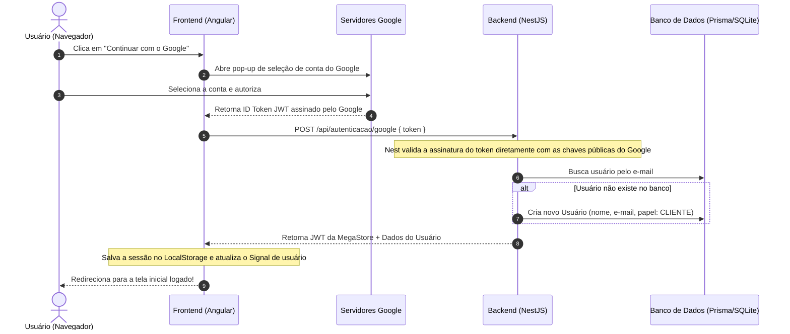

# 🔐 Guia Completo: Autenticação com Google (OAuth 2.0)

Este documento descreve detalhadamente a arquitetura, configuração no Google Cloud e a implementação passo a passo da autenticação com o **Google Sign-In (Google Identity Services)** no projeto E-commerce com **NestJS**, **Prisma** e **Angular**.

---

## 📌 1. Visão Geral da Arquitetura

Em aplicações modernas (Single Page Application - SPA), o fluxo recomendado pelo próprio Google é o **Google Identity Services (Token-Based)**, que não requer recarregar a página ou redirecionar o usuário para fora da loja:



---

## ☁️ 2. Configuração no Google Cloud Console

### Passo 2.1: Criar o Projeto
1. Acesse o **[Google Cloud Console](https://console.cloud.google.com/)**.
2. No menu superior, clique no seletor de projetos e escolha **"Novo Projeto"**.
3. Dê um nome ao projeto (ex: `MegaStore E-commerce`) e clique em **Criar**.

---

### Passo 2.2: Configurar a Tela de Permissão OAuth
1. No menu lateral esquerdo, vá em **APIs e Serviços** > **Tela de permissão OAuth**.
2. Em **Tipo de Usuário**, selecione **Externo** e clique em **Criar**.
   > *Nota:* A opção "Interno" só existe para empresas com Google Workspace corporativo. "Externo" permite que qualquer pessoa com conta Google use a sua loja.
3. Preencha as informações obrigatórias da aplicação:
   - **Nome do app**: `MegaStore`
   - **E-mail para suporte do usuário**: Selecione o seu próprio e-mail.
   - **Dados de contato do desenvolvedor**: Digite o seu e-mail.
4. Clique em **Salvar e Continuar**.
5. Na etapa de **Escopos**, não precisa alterar nada (o Google já inclui permissões de e-mail e perfil por padrão). Clique em **Salvar e Continuar**.
6. Na etapa de **Usuários de teste**, adicione o seu e-mail do Google para testar em desenvolvimento.
7. Clique em **Salvar e Continuar** até finalizar.

---

### Passo 2.3: Criar as Credenciais do Cliente Web
1. No menu lateral esquerdo, clique em **Credenciais**.
2. Clique no botão superior **+ CRIAR CREDENCIAIS** e escolha **ID do cliente OAuth**.
3. Configure os seguintes campos com exatidão:
   - **Tipo de aplicativo**: `Aplicativo da Web` (Web application).
   - **Nome**: `MegaStore Web Client`.
   - **Origens JavaScript autorizadas** *(CRUCIAL)*:
     - Clique em **+ ADICIONAR URI** e insira:
       ```text
       http://localhost:4200
       ```
     - Clique em **+ ADICIONAR URI** e insira:
       ```text
       http://localhost:3000
       ```
   - **URIs de redirecionamento autorizados**:
     - Clique em **+ ADICIONAR URI** e insira:
       ```text
       http://localhost:4200
       ```
4. Clique no botão azul **Criar** no rodapé.
5. Uma janela suspensa aparecerá exibindo:
   - **ID do cliente**: Algo no formato `1234567890-abcdefghij.apps.googleusercontent.com`.
   - **Chave secreta do cliente**: Uma sequência secreta de caracteres.
6. Guarde o seu **ID do cliente**.

---

## 🛠️ 3. Implementação no Backend (NestJS + Prisma)

### Passo 3.1: Instalar a Biblioteca Oficial do Google
No diretório `backend`, instale a biblioteca do Google para verificação de tokens:
```bash
npm install google-auth-library
```

---

### Passo 3.2: Configurar o `.env`
Adicione o seu ID no arquivo `backend/.env`:
```ini
GOOGLE_CLIENT_ID="SEU_CLIENT_ID_AQUI.apps.googleusercontent.com"
```

---

### Passo 3.3: Criar o DTO de Entrada
Crie o arquivo `backend/src/modules/autenticacao/dto/google-entrar.dto.ts`:
```typescript
import { ApiProperty } from '@nestjs/swagger';
import { IsNotEmpty, IsString } from 'class-validator';

export class GoogleEntrarDto {
  @ApiProperty({
    description: 'Token JWT (credential) retornado pelo Google Identity Services',
    example: 'eyJhbGciOiJSUzI1NiIsImtpZCI6Ij...',
  })
  @IsString({ message: 'O token deve ser uma string' })
  @IsNotEmpty({ message: 'O token do Google é obrigatório' })
  token: string;
}
```

---

### Passo 3.4: Adicionar o Método no `AutenticacaoService`
No arquivo `backend/src/modules/autenticacao/autenticacao.service.ts`:
```typescript
import { Injectable, UnauthorizedException } from '@nestjs/common';
import { ConfigService } from '@nestjs/config';
import { OAuth2Client } from 'google-auth-library';
import { PrismaService } from '../../prisma/prisma.service';
import { JwtService } from '@nestjs/jwt';

@Injectable()
export class AutenticacaoService {
  private googleClient: OAuth2Client;

  constructor(
    private readonly prisma: PrismaService,
    private readonly jwtService: JwtService,
    private readonly configService: ConfigService,
  ) {
    const googleClientId = this.configService.get<string>('GOOGLE_CLIENT_ID');
    this.googleClient = new OAuth2Client(googleClientId);
  }

  async entrarComGoogle(tokenGoogle: string) {
    let payload;

    try {
      // 1. Valida criptograficamente o token recebido com os servidores do Google
      const ticket = await this.googleClient.verifyIdToken({
        idToken: tokenGoogle,
        audience: this.configService.get<string>('GOOGLE_CLIENT_ID'),
      });
      payload = ticket.getPayload();
    } catch (erro) {
      throw new UnauthorizedException('Token do Google inválido ou expirado');
    }

    if (!payload || !payload.email) {
      throw new UnauthorizedException('Não foi possível obter os dados do Google');
    }

    const { email, name } = payload;

    // 2. Busca o usuário pelo e-mail ou cria um novo registro
    let usuario = await this.prisma.usuario.findUnique({
      where: { email },
    });

    if (!usuario) {
      usuario = await this.prisma.usuario.create({
        data: {
          nome: name || 'Usuário Google',
          email: email,
          senha: '', // Usuários autenticados via provedor social não usam senha local
          papel: 'CLIENTE',
        },
      });
    }

    // 3. Emite o token JWT oficial da sua aplicação
    const token = this.jwtService.sign({
      sub: usuario.id,
      email: usuario.email,
      papel: usuario.papel,
    });

    return {
      usuario: {
        id: usuario.id,
        nome: usuario.nome,
        email: usuario.email,
        papel: usuario.papel,
      },
      token,
    };
  }
}
```

---

### Passo 3.5: Adicionar o Endpoint no `AutenticacaoController`
No arquivo `backend/src/modules/autenticacao/autenticacao.controller.ts`:
```typescript
import { Body, Controller, Post } from '@nestjs/common';
import { ApiTags, ApiOperation, ApiResponse } from '@nestjs/swagger';
import { GoogleEntrarDto } from './dto/google-entrar.dto';

@ApiTags('Autenticação')
@Controller('autenticacao')
export class AutenticacaoController {
  // ... outros métodos (cadastrar, entrar) ...

  @Post('google')
  @ApiOperation({ summary: 'Autenticar ou cadastrar usuário via Google OAuth 2.0' })
  @ApiResponse({ status: 200, description: 'Usuário autenticado com sucesso' })
  @ApiResponse({ status: 401, description: 'Token do Google inválido' })
  async entrarComGoogle(@Body() dto: GoogleEntrarDto) {
    return this.authService.entrarComGoogle(dto.token);
  }
}
```

---

## 🎨 4. Implementação no Frontend (Angular 18)

### Passo 4.1: Carregar o Script Oficial do Google
No arquivo `frontend/src/index.html`, adicione a biblioteca dentro da tag `<head>`:
```html
<script src="https://accounts.google.com/gsi/client" async defer></script>
```

---

### Passo 4.2: Atualizar o `AutenticacaoService` no Frontend
No arquivo `frontend/src/app/core/services/autenticacao.service.ts`:
```typescript
entrarComGoogle(tokenGoogle: string): Observable<RespostaAutenticacao> {
  return this.api.post<RespostaAutenticacao>('autenticacao/google', { token: tokenGoogle }).pipe(
    tap((resposta) => {
      this.salvarSessao(resposta.usuario, resposta.token);
    }),
  );
}
```

---

### Passo 4.3: Renderizar o Botão na Página de Login
No arquivo `frontend/src/app/features/auth/login/login.component.ts`:
```typescript
import { Component, OnInit, inject, signal, ElementRef, ViewChild } from '@angular/core';

declare const google: any;

export class LoginComponent implements OnInit {
  @ViewChild('googleButton', { static: true }) googleButton!: ElementRef;

  ngOnInit() {
    this.iniciarBotaoGoogle();
  }

  iniciarBotaoGoogle() {
    if (typeof google === 'undefined') {
      setTimeout(() => this.iniciarBotaoGoogle(), 200);
      return;
    }

    google.accounts.id.initialize({
      client_id: 'SEU_CLIENT_ID_AQUI.apps.googleusercontent.com',
      callback: (resposta: any) => this.aoAutenticarGoogle(resposta),
    });

    google.accounts.id.renderButton(this.googleButton.nativeElement, {
      theme: 'outline',
      size: 'large',
      text: 'continue_with',
      shape: 'rectangular',
      width: 380,
    });
  }

  aoAutenticarGoogle(resposta: any) {
    if (resposta.credential) {
      this.carregando.set(true);
      this.authService.entrarComGoogle(resposta.credential).subscribe({
        next: () => {
          this.carregando.set(false);
          this.router.navigate(['/']);
        },
        error: (erro) => {
          this.carregando.set(false);
          this.mensagemErro.set('Falha na autenticação com o Google.');
        },
      });
    }
  }
}
```

No template `frontend/src/app/features/auth/login/login.component.html`:
```html
<!-- Separador visual -->
<div class="divider">
  <span>ou</span>
</div>

<!-- Container do Botão Oficial do Google -->
<div #googleButton class="google-button-container"></div>
```

---

## 🔒 5. Segurança & Boas Práticas

1. **Nunca confie nos dados vindos do navegador**:
   - Jamais confie se o frontend mandar apenas `{ email: 'cliente@gmail.com' }` sem o token assinado. Qualquer atacante poderia enviar o e-mail de outra pessoa e se passar por ela.
   - A biblioteca `google-auth-library` verifica a assinatura criptográfica usando os certificados públicos do Google. Se o token tiver sido adulterado, o backend rejeita com erro `401 Unauthorized`.
2. **Separação de Tokens**:
   - O token emitido pelo Google só serve para **provar a identidade** durante o login.
   - Uma vez comprovada a identidade, o seu backend emite o **seu próprio JWT**, que controla a sessão e os papéis (`CLIENTE` ou `ADMIN`) nas rotas da sua loja.
3. **Migração para Produção**:
   - Quando você publicar a loja em um domínio real (ex: `https://minhaloja.com.br`), basta voltar no Google Cloud Console e adicionar esse novo domínio nas **Origens JavaScript autorizadas**. O Google exige protocolo `HTTPS` obrigatório em produção.

---

## ❓ 6. Perguntas Frequentes & Resolução de Problemas

- **Erro `origin_mismatch`:**
  - Ocorre quando a porta ou o protocolo do navegador não bate exatamente com o cadastrado no Google Console. Verifique se `http://localhost:4200` está cadastrado sem barra no final.
- **Erro `popup_closed_by_user`:**
  - Ocorre se o cliente fechou a janela do Google antes de concluir a escolha da conta. O front-end pode ignorar ou exibir um aviso amigável.
